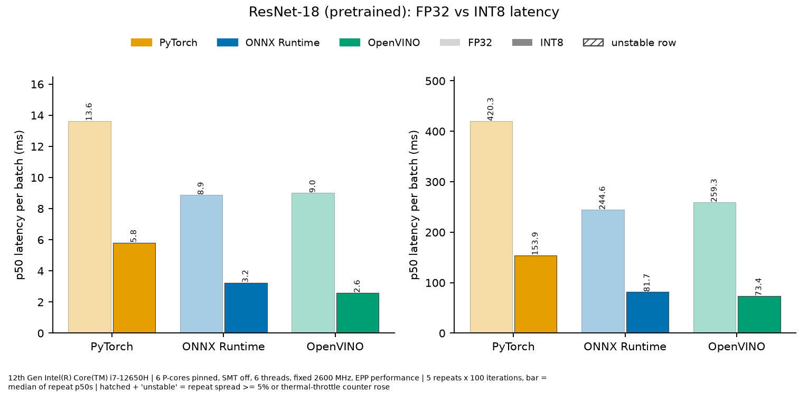
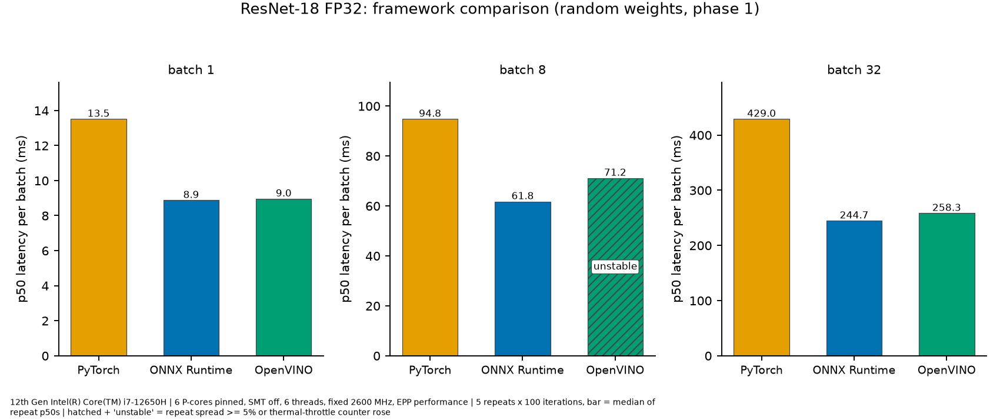
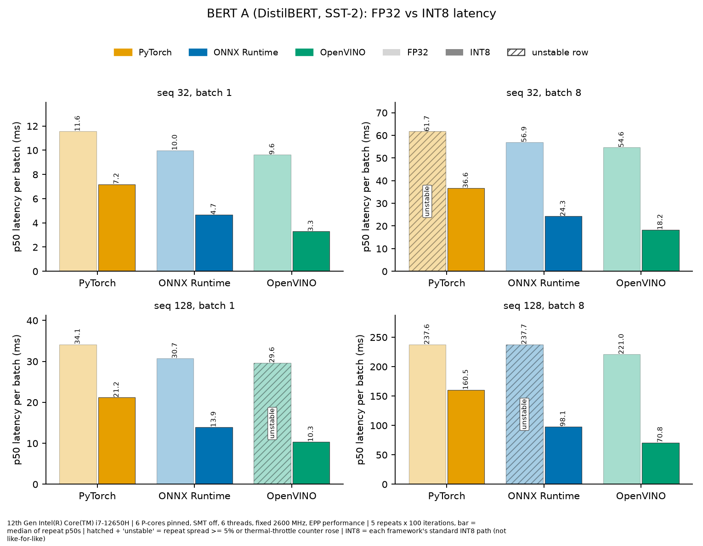
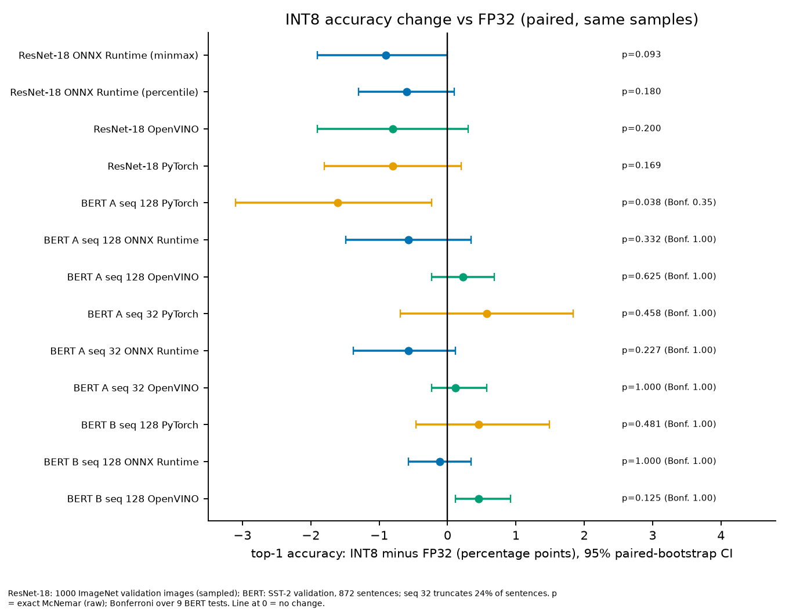

# CPU inference benchmark: PyTorch vs ONNX Runtime vs OpenVINO, FP32 vs INT8

> Generated from `docs/README.template.md` by `bench/build_readme.py`. Every number below is read from `results/**/*.json`
> (list with sources: `docs/readme_numbers.tsv`).

## Results at a glance

| | PyTorch | ONNX Runtime | OpenVINO |
|---|---|---|---|
| ResNet-18, batch 1: FP32 → INT8 p50 and speedup | 13.6 → 5.8 ms (2.34×) | 8.9 → 3.2 ms (2.74×) | 9.0 → 2.6 ms (3.48×) |
| ResNet-18 top-1 change INT8 − FP32 (pt, 95% CI) | −0.8 [−1.8, +0.2] | −0.9 [−1.9, +0.0] | −0.8 [−1.9, +0.3] |
| ResNet-18, batch 1: INT8 p50 (lowest in bold) | 5.8 ms (172 img/s) | 3.2 ms (309 img/s) | **2.6 ms (386 img/s)** |
| ResNet-18 FP32, batch 1: speedup vs PyTorch | — | 1.52× | 1.51× |
| BERT A, seq 128, batch 1: INT8 speedup vs FP32 | 1.61× | 2.21× | n/a (FP32 row unstable; INT8 10.3 ms) |
| BERT A, seq 128 top-1 change INT8 − FP32 (pt, 95% CI) | −1.61 [−3.10, −0.23] | −0.57 [−1.49, +0.34] | +0.23 [−0.23, +0.69] |

Conditions: 12th Gen Intel(R) Core(TM) i7-12650H, six P-cores pinned with SMT off, fixed 2600 MHz, 6 threads, p50 over 5 repeats × 100 iterations; ratios only between stable rows.
INT8 = each framework's standard INT8 path (not like-for-like); ResNet-18 accuracy on a 1000-image sample, BERT on the 872-sentence SST-2 validation set.



## Summary

On one laptop CPU, INT8 was faster than FP32 in every pair of stable measurements, for all three frameworks: 2.34×–3.53× for ResNet-18
(7 stable pairs) and 1.10×–3.12× for two small SST-2 BERT-family models (14 stable pairs). OpenVINO had the lowest INT8 latency in every configuration.
Accuracy changes were small; no result is significant after correction for multiple tests at these sample sizes (one nominal and one borderline interval are discussed below).
Some rows are unstable and carry no ratio; INT8 paths differ per framework (see Limitations). Profiling shows where time goes but does not explain the speedup.

## Hardware and software

- CPU: 12th Gen Intel(R) Core(TM) i7-12650H (6 P-cores + 4 E-cores, 16 logical CPUs; sustained package power limit 45 W, short-term 115 W). Laptop on AC power.
- Only the 6 P-cores were used (`taskset -c 0,2,4,6,8,10`); their SMT siblings were taken offline for the main experiments; E-cores were not used.
- Python 3.12.15; PyTorch 2.14.1+cpu, ONNX Runtime 1.31.0, OpenVINO 2026.4.1 (NNCF `3.4.0` for OpenVINO quantization, in a separate venv),
  `transformers 5.20.2` for the BERT models. OS: `Fedora Linux 44`, kernel `7.2.8`.
- Models: torchvision ResNet-18 (`IMAGENET1K_V1` weights for all INT8 / accuracy results; seeded random weights for the phase-1 FP32 latency table);
  BERT-family models fine-tuned on SST-2: **A** = `distilbert/distilbert-base-uncased-finetuned-sst-2-english` (Apache-2.0),
  **B** = `M-FAC/bert-mini-finetuned-sst2` (the model card states no license; used for a private benchmark only).

## Methodology

**Machine state (all measured runs).** Package power/thermal limits make a laptop CPU a poor benchmark target unless controlled. An uncontrolled first attempt (default frequency scaling)
was invalid (12 of 18 repeated rows differed by more than 5% between two identical runs; archived, see below). A pilot with the cores capped at 3000 MHz still raised thermal-throttle counters in
2 of 4 rows (archived). All reported runs therefore use:
- frequency fixed by `scaling_min_freq = scaling_max_freq = 2600` MHz on the P-cores (a sustained clock the cores can hold; **not** the peak clock),
  energy-performance preference `performance`, SMT siblings offline, AC power, `tuned`, `thermald` and the desktop search indexer stopped, browser closed;
- **a VPN client (ExpressVPN) was running during all runs** (a background service; its effect was not measured);
- a cooldown wait until the package temperature is below 60 °C before every repeat (maximum wait 180 s; timeouts are recorded, none occurred in the reported runs).

**Measurement.** One process = one repeat: model load, tokenization/data and (PyTorch INT8) quantization happen before the cooldown and outside the timed region;
then 10 untimed warmup iterations and 100 timed iterations (`time.perf_counter`, single-stream, latency mode). 5 independent repeats per configuration,
6 threads. Rounds are **interleaved** (for each configuration and round: each framework, FP32 then INT8) so drift hits all frameworks equally.
The reported p50 is the median of the per-repeat p50 values; "spread" is (max − min) / median over the repeat p50s.
Telemetry per repeat: package temperature, mean/min P-core frequency (sampled every 250 ms), and the kernel's thermal-throttle counters.
**Stability rule:** a row is *stable* if its spread is below 5%, no thermal-throttle counter increased, and it has 5 repeats.
Speedup ratios are only printed between two stable rows; unstable rows are shown and marked, never dropped.
Thermal counters do not detect power-limit throttling; frequency columns in `results/*/summary.csv` are the check for that.
Inputs: ResNet-18 latency uses a seeded random tensor (phase 1) or the same shape with pretrained weights (INT8 study); BERT latency uses real tokenized SST-2
validation sentences padded/truncated to a fixed length, identical arrays for all frameworks.
Thread count, streams and hints are set explicitly (OpenVINO: latency hint, one stream) and recorded in each result JSON, together with an execution check
that the INT8 model really executes INT8 operators (per-framework operator counts).

**INT8 methods (fixed before looking at accuracy).**
- ResNet-18: ONNX Runtime static QDQ (per-channel INT8 weights, MinMax calibration is the primary variant, Percentile a secondary variant); OpenVINO NNCF
  post-training quantization with default settings; PyTorch FX graph-mode static quantization with the default `x86` qconfig. Calibration: 300 images disjoint from the evaluation images.
- BERT: ONNX Runtime `quantize_dynamic` (per-channel INT8 weights, dynamic activations); OpenVINO NNCF with `model_type=TRANSFORMER`, default preset (static, 300 SST-2
  *training* sentences for calibration); PyTorch `quantize_dynamic` on `nn.Linear` (per-tensor weights, `x86` engine). No validation data was used for calibration.

**Accuracy method.** FP32 and INT8 are evaluated on the *same* samples. The difference in top-1 accuracy has a 95% paired-bootstrap confidence interval
(5000 resamples, fixed seed) and an exact McNemar test on the discordant pairs. For BERT, nine comparisons (three frameworks × three model/length settings) are
reported, so the McNemar p-values are also shown multiplied by 9 (Bonferroni, capped at 1). FP32 provenance check: the SST-2 accuracy of the FP32 models must match the model cards
(A 91.06%, B 84.74%): measured A 91.06%, B 84.75% at sequence length 128, identical in all three frameworks.

## Results

### ResNet-18 FP32 latency (phase 1, random weights; 45 processes)

| batch | framework | p50 (ms) | p95 (ms) | throughput (img/s) | spread (%) | speedup vs PyTorch | stable |
|---|---|---|---|---|---|---|---|
| 1 | PyTorch | 13.5 | 13.9 | 74.0 | 4.7 | — | yes |
| 1 | ONNX Runtime | 8.9 | 8.9 | 112.7 | 0.4 | 1.52× | yes |
| 1 | OpenVINO | 9.0 | 9.6 | 111.6 | 3.2 | 1.51× | yes |
| 8 | PyTorch | 94.8 | 95.3 | 84.4 | 2.5 | — | yes |
| 8 | ONNX Runtime | 61.8 | 62.1 | 129.5 | 1.2 | 1.53× | yes |
| 8 | OpenVINO | 71.2 | 72.2 | 112.4 | 6.9 | n/a (unstable) | **UNSTABLE** |
| 32 | PyTorch | 429.0 | 431.5 | 74.6 | 1.0 | — | yes |
| 32 | ONNX Runtime | 244.7 | 245.5 | 130.8 | 2.7 | 1.75× | yes |
| 32 | OpenVINO | 258.3 | 280.3 | 123.9 | 1.0 | 1.66× | yes |

Unstable rows: 1 of 9 (no ratio is printed for them).



SMT experiment (12 threads on the 6 P-cores with SMT on; 45 processes; 3 of 9 rows unstable). Only rows that are stable in both settings are shown;
the two settings were run minutes apart, not interleaved with each other, so treat this as indicative:

| framework | batch | 6 threads p50 (ms) | 12 threads (SMT on) p50 (ms) |
|---|---|---|---|
| PyTorch | 1 | 13.5 | 13.4 |
| PyTorch | 8 | 94.8 | 90.0 |
| ONNX Runtime | 1 | 8.9 | 8.2 |
| OpenVINO | 1 | 9.0 | 8.7 |
| OpenVINO | 32 | 258.3 | 242.9 |

### ResNet-18 FP32 vs INT8 (pretrained weights; 90 processes)

| batch | framework | FP32 p50 (ms) | INT8 p50 (ms) | INT8 speedup | INT8 p50 vs PyTorch INT8 | FP32 spread / INT8 spread (%) | stable (FP32/INT8) |
|---|---|---|---|---|---|---|---|
| 1 | PyTorch | 13.6 | 5.8 | 2.34× | — | 2.7 / 0.4 | yes / yes |
| 1 | ONNX Runtime | 8.9 | 3.2 | 2.74× | 1.80× | 1.4 / 1.0 | yes / yes |
| 1 | OpenVINO | 9.0 | 2.6 | 3.48× | 2.24× | 2.3 / 0.2 | yes / yes |
| 8 | PyTorch | 91.1 | 39.3 | n/a (unstable) | — | 5.9 / 0.8 | **NO** / yes |
| 8 | ONNX Runtime | 61.8 | 21.1 | 2.93× | 1.86× | 1.9 / 0.9 | yes / yes |
| 8 | OpenVINO | 71.3 | 18.9 | n/a (unstable) | 2.07× | 9.5 / 0.3 | **NO** / yes |
| 32 | PyTorch | 420.3 | 153.9 | 2.73× | — | 2.0 / 0.5 | yes / yes |
| 32 | ONNX Runtime | 244.6 | 81.7 | 2.99× | 1.88× | 2.8 / 0.2 | yes / yes |
| 32 | OpenVINO | 259.3 | 73.4 | 3.53× | 2.10× | 3.0 / 0.2 | yes / yes |

Unstable rows: 2 of 18. The INT8 speedup is not printed where either side is unstable.


### BERT FP32 vs INT8 (180 processes; `INT8` = each framework's standard path, not like-for-like)

Model A (DistilBERT, SST-2):

| seq | batch | framework | FP32 p50 (ms) | INT8 p50 (ms) | INT8 speedup | INT8 vs PyTorch INT8 | stable (FP32/INT8) |
|---|---|---|---|---|---|---|---|
| 32 | 1 | PyTorch | 11.6 | 7.2 | 1.61× | — | yes / yes |
| 32 | 1 | ONNX Runtime | 10.0 | 4.7 | 2.14× | 1.54× | yes / yes |
| 32 | 1 | OpenVINO | 9.6 | 3.3 | 2.93× | 2.19× | yes / yes |
| 32 | 8 | PyTorch | 61.7 | 36.6 | n/a (unstable) | — | **NO** / yes |
| 32 | 8 | ONNX Runtime | 56.9 | 24.3 | 2.35× | 1.51× | yes / yes |
| 32 | 8 | OpenVINO | 54.6 | 18.2 | 3.00× | 2.01× | yes / yes |
| 128 | 1 | PyTorch | 34.1 | 21.2 | 1.61× | — | yes / yes |
| 128 | 1 | ONNX Runtime | 30.7 | 13.9 | 2.21× | 1.52× | yes / yes |
| 128 | 1 | OpenVINO | 29.6 | 10.3 | n/a (unstable) | 2.05× | **NO** / yes |
| 128 | 8 | PyTorch | 237.6 | 160.5 | 1.48× | — | yes / yes |
| 128 | 8 | ONNX Runtime | 237.7 | 98.1 | n/a (unstable) | 1.64× | **NO** / yes |
| 128 | 8 | OpenVINO | 221.0 | 70.8 | 3.12× | 2.27× | yes / yes |

Model B (BERT-mini, SST-2; sequence length 128 only):

| seq | batch | framework | FP32 p50 (ms) | INT8 p50 (ms) | INT8 speedup | INT8 vs PyTorch INT8 | stable (FP32/INT8) |
|---|---|---|---|---|---|---|---|
| 128 | 1 | PyTorch | 4.8 | 4.3 | 1.10× | — | yes / yes |
| 128 | 1 | ONNX Runtime | 3.8 | 2.7 | 1.40× | 1.59× | yes / yes |
| 128 | 1 | OpenVINO | 3.0 | 1.6 | 1.94× | 2.78× | yes / yes |
| 128 | 8 | PyTorch | 23.2 | 22.0 | n/a (unstable) | — | **NO** / **NO** |
| 128 | 8 | ONNX Runtime | 23.8 | 14.0 | 1.70× | n/a (unstable) | yes / yes |
| 128 | 8 | OpenVINO | 18.8 | 8.3 | 2.26× | n/a (unstable) | yes / yes |

Unstable rows: 5 of 36.



### Accuracy: INT8 minus FP32 (paired)

ResNet-18 (1000 ImageNet validation images; the FP32 top-1 on the sample is 70.5%). All four intervals include zero; the ONNX Runtime MinMax interval's upper bound is
exactly +0.0, i.e. borderline:

| framework | INT8 method | FP32 top-1 (%) | INT8 top-1 (%) | diff (pt) | 95% CI (pt) | FP32-only / INT8-only correct | McNemar p |
|---|---|---|---|---|---|---|---|
| ONNX Runtime | static QDQ, MinMax (primary) | 70.5 | 69.6 | −0.9 | [−1.9, +0.0] | 16 / 7 | 0.093 |
| ONNX Runtime | static QDQ, Percentile (secondary) | 70.5 | 69.9 | −0.6 | [−1.3, +0.1] | 10 / 4 | 0.180 |
| OpenVINO | NNCF PTQ, default | 70.5 | 69.7 | −0.8 | [−1.9, +0.3] | 19 / 11 | 0.200 |
| PyTorch | FX graph mode, x86 qconfig | 70.5 | 69.7 | −0.8 | [−1.8, +0.2] | 17 / 9 | 0.169 |

BERT (SST-2 validation, 872 sentences). Sequence length 32 truncates 208 of 872 sentences (24%), which lowers FP32 accuracy of model A to
89.91% (versus 91.06% at length 128); the seq-32 rows are reported separately for that reason.

| model | seq | framework | FP32 acc (%) | INT8 acc (%) | diff (pt) | 95% CI (pt) | FP32-only / INT8-only | McNemar p (raw) | p (Bonferroni ×9) |
|---|---|---|---|---|---|---|---|---|---|
| A | 128 | PyTorch | 91.06 | 89.45 | −1.61 | [−3.10, −0.23] | 27 / 13 | 0.038 | 0.35 |
| A | 128 | ONNX Runtime | 91.06 | 90.48 | −0.57 | [−1.49, +0.34] | 11 / 6 | 0.332 | 1.00 |
| A | 128 | OpenVINO | 91.06 | 91.28 | +0.23 | [−0.23, +0.69] | 1 / 3 | 0.625 | 1.00 |
| A | 32 | PyTorch | 89.91 | 90.48 | +0.57 | [−0.69, +1.83] | 12 / 17 | 0.458 | 1.00 |
| A | 32 | ONNX Runtime | 89.91 | 89.33 | −0.57 | [−1.38, +0.11] | 8 / 3 | 0.227 | 1.00 |
| A | 32 | OpenVINO | 89.91 | 90.02 | +0.11 | [−0.23, +0.57] | 1 / 2 | 1.000 | 1.00 |
| B | 128 | PyTorch | 84.75 | 85.21 | +0.46 | [−0.46, +1.49] | 7 / 11 | 0.481 | 1.00 |
| B | 128 | ONNX Runtime | 84.75 | 84.63 | −0.11 | [−0.57, +0.34] | 3 / 2 | 1.000 | 1.00 |
| B | 128 | OpenVINO | 84.75 | 85.21 | +0.46 | [+0.11, +0.92] | 0 / 4 | 0.125 | 1.00 |

The one nominal result (A, seq 128, PyTorch dynamic INT8: −1.61 pt, raw p=0.038) is **nominal, not significant after Bonferroni over
9 tests** (p=0.35). All other BERT differences lie between −0.57 and 0.57 points.
One more row needs a caveat: for model B with OpenVINO the bootstrap interval (+0.46 pt, [+0.11, +0.92]) excludes zero (an accuracy *gain*), but the exact McNemar test on only
0 versus 4 discordant pairs gives p=0.125; I read this as noise-level, not as evidence that INT8 improves accuracy.



### Profiling (observations only)

Profiled runs (PyTorch `torch.profiler`, ONNX Runtime `enable_profiling`, OpenVINO `PERF_COUNT`; ResNet-18, 6 threads) are **separate** from the timing runs and include
profiler overhead; their milliseconds must not be compared with the timing tables. One profiled run per configuration, so there is no spread estimate.

| framework | precision | batch | conv time (ms) | conv share of profiled time (%) | quantize/dequantize share (%) | profiled total (ms) |
|---|---|---|---|---|---|---|
| PyTorch | FP32 | 1 | 11.8 | 84.4 | 0.0 | 14.0 |
| PyTorch | INT8 | 1 | 5.2 | 94.4 | 0.3 | 5.5 |
| ONNX Runtime | FP32 | 1 | 8.9 | 98.2 | 0.0 | 9.0 |
| ONNX Runtime | INT8 | 1 | 3.2 | 89.1 | 0.8 | 3.6 |
| OpenVINO | FP32 | 1 | 9.0 | 97.2 | 0.8 | 9.2 |
| OpenVINO | INT8 | 1 | 2.6 | 93.7 | 1.7 | 2.7 |
| PyTorch | FP32 | 32 | 303.6 | 80.8 | 0.0 | 375.8 |
| PyTorch | INT8 | 32 | 150.4 | 97.1 | 0.5 | 154.9 |
| ONNX Runtime | FP32 | 32 | 242.3 | 98.5 | 0.0 | 246.0 |
| ONNX Runtime | INT8 | 32 | 75.0 | 92.2 | 0.8 | 81.3 |
| OpenVINO | FP32 | 32 | 252.4 | 97.7 | 0.6 | 258.4 |
| OpenVINO | INT8 | 32 | 69.9 | 96.8 | 0.6 | 72.2 |

- Convolution layers dominate the profiled time in every profile, FP32 and INT8; in the INT8 profiles the convolution time itself is much smaller than in FP32
  (compare the conv-time column), while quantize/dequantize operators take a small share (column above).
- Implementation names reported by OpenVINO at batch 1 — FP32 convolutions: `brgconv_avx2_f32` ×17, `brgconv_avx2_1x1_f32` ×3; INT8 convolutions: `brgconv_avx2_I8` ×16, `brgconv_avx2_1x1_I8` ×3, `jit_avx2_I8` ×1.
  These names contain `avx2` and `I8` but **no name contains `vnni`**; the names alone do not show whether VNNI instructions are used. I make no claim about the cause of the INT8 speedup.
- ONNX Runtime and PyTorch profilers report operator types only (`QLinearConv`, `QGemm`, `quantized::conv2d`), not kernel or instruction-set names.
- The PyTorch FP32 profile lists batch-norm and ReLU as separate operators, while the INT8 profile lists fused `quantized::conv2d_relu`; I did not test how much of the gap that explains.

## Takeaways

- INT8 was faster than FP32 in every stable pair, in all three frameworks (7 ResNet-18 pairs, 14 BERT pairs).
- The smallest INT8 speedups were PyTorch's (2.34× ResNet-18, 1.10× on the small BERT model B at batch 1); the largest were OpenVINO's (3.53× ResNet-18, 3.12× BERT).
- OpenVINO's INT8 model had the lowest p50 among the INT8 rows in all 9 configurations compared (checked by the build script); this compares each framework's standard INT8 path, not identical quantization.
- With SMT on (12 threads), p50 was 0.6%–7.5% lower than with 6 threads in the 5 pairs that were stable in both settings. That is a small gain and indicative only (the two settings were not interleaved).
- Accuracy: INT8 changed top-1 by small amounts; no ResNet-18 interval lies entirely below zero and no BERT result is significant after Bonferroni correction. The sample sizes cannot resolve effects of a few tenths of a point.
- Convolutions are the large majority of profiled time in every ResNet-18 profile; the profiling does not by itself say why INT8 is faster.

## What I would do next

- Verify whether VNNI instructions are actually used (hardware performance counters or disassembly of the hot kernels) instead of inferring from kernel names.
- Repeat the comparison on an AVX-512/AMX server CPU, where INT8 hardware support differs.
- Evaluate ResNet-18 on the full ImageNet validation set instead of a sample.
- Add ONNX Runtime *static* QDQ quantization for BERT as a closer match to OpenVINO's static path.
- Investigate the recurring unstable OpenVINO FP32 batch-8 row of ResNet-18 (unstable in two separate campaigns).

## Limitations

- **One laptop, one CPU, one run campaign.** Results say nothing about other CPUs (especially AVX-512/AMX server parts) or other systems; the machine has a hybrid CPU and was
  run with only the P-cores.
- **Sustained 2600 MHz, not peak clock.** Absolute numbers are below what the machine does at boost; only same-clock comparisons are meaningful.
- **Thermal-only throttle counters.** Power-limit throttling is not detected automatically; I inspected frequency columns instead.
- **ResNet accuracy uses a 1000-image sample** of ImageNet validation images drawn by random byte offsets from remote archives, which is mildly size-biased; confidence
  intervals are wide (a few tenths of a point cannot be resolved). It is not a full-validation-set result. The sample's FP32 top-1 (70.5%) was checked against torchvision's published full-validation accuracy before any INT8 work (provenance check).
- **INT8 coverage differs per framework.** OpenVINO's NNCF transformer preset also quantizes the attention matmuls; ONNX Runtime and PyTorch dynamic quantization only quantize
  `Linear`/MatMul layers with weights. PyTorch uses per-tensor weights, ONNX Runtime per-channel; ONNX Runtime and PyTorch quantize activations dynamically, OpenVINO statically.
  The BERT comparison is therefore between each framework's standard INT8 path, not a like-for-like INT8 comparison.
- **Deprecated / legacy tooling.** The PyTorch FX graph-mode quantization API (`torch.ao`) is deprecated; the ONNX exports use the legacy TorchScript exporter (with tracer warnings that I
  checked numerically, two checks for BERT: (a) in every FP32 timing row, ONNX Runtime and OpenVINO logits vs PyTorch differ by at most 1.7e-06
  (the first `batch` validation sentences); (b) a separate export check of ONNX Runtime vs PyTorch on 64 validation sentences at every timing-grid shape (batch 1 and 8, seq 32 and 128) gives at most
  9.5e-06 for model A and 3.4e-06 for model B (`results/exec_check_bert/export_check.json`). The maximum over all checks is 9.5e-06. For ResNet-18 the FP32 timing rows differ by at most 9.1e-06).
- **Model B's license is unclear** (no license field on the model card); it was used locally for benchmarking only and is not redistributed.
- **Sequence length 32 truncates 24% of SST-2 validation sentences**; accuracy at that length is reported separately.
- **Profiling** is one run per configuration with profiler overhead, and kernel names do not identify instruction-level behaviour.
- **Some stable-looking rows are only just stable** (spread close to the 5% limit) and several rows are unstable; none were hidden.
- **A VPN client (ExpressVPN) was running** during all runs; its effect is unmeasured.
- **Archives of invalid runs** are kept locally (not in this repository) and summarized here:
  (1) the first uncontrolled attempt (12 of 18 repeated rows differed by more than 5%);
  (2) a pilot at 3000 MHz (2 of 4 rows raised throttle counters);
  (3) a pilot whose energy-performance preference was not the intended one (unexplained setting change);
  (4) the first BERT FP32 provenance check, which gave 49.08% accuracy for all six runs because of a tokenizer bug in my code (every word became `[UNK]`), found by the provenance gate and fixed before any BERT result was used.

## Reproduce

Data and models are **not** included in this repository. The code is MIT-licensed (`LICENSE`); the datasets and model weights keep their own licenses and terms
(ImageNet images: non-commercial research terms; ResNet-18 weights: torchvision; SST-2/GLUE: original dataset licenses; model A: Apache-2.0; model B: no license stated on its card).

Pinned environments (`uv pip freeze`): `requirements/main.txt` (main venv `.venv`; the `+cpu` PyTorch builds come from the PyTorch CPU wheel index) and `requirements/quant.txt`
(`.venv-quant`, used only for OpenVINO/NNCF quantization because its NumPy pin differs).

```bash
uv venv .venv && uv pip install --python .venv/bin/python -r requirements/main.txt --extra-index-url https://download.pytorch.org/whl/cpu
uv venv .venv-quant && uv pip install --python .venv-quant/bin/python -r requirements/quant.txt

scripts/bench_state.sh on        # needs sudo: stop tuned/thermald/indexer, EPP performance, P-cores fixed at the cap, SMT siblings offline; prints verification
./run_all.sh pilot               # short check of the setup (preflight refuses to run in the wrong machine state)
./run_all.sh phase1              # ResNet-18 FP32 comparison (random weights); ./run_all.sh phase2 = SMT experiment (siblings online)
# ResNet-18 INT8: data prep in bench/data_prep/, quantization: bench/quant/{ort_int8,pt_int8}.py with .venv, bench/quant/ov_int8.py with .venv-quant
./run_all.sh stage2              # ResNet-18 FP32 vs INT8 (pretrained weights)
./profile_all.sh                 # profiling runs (separate from timing)
.venv/bin/python bench/bert_prep.py                          # BERT: tokenization + ONNX export (needs data/bert/ files)
.venv/bin/python bench/quant/bert_ort_int8.py A              # also B; .venv-quant/bin/python bench/quant/bert_ov_int8.py A 128 (also A 32, B 128)
.venv/bin/python bench/bert_accuracy.py A pytorch fp32 128   # accuracy runs; bench/bert_accuracy_compare.py for the paired table
./run_all.sh bert_smoke && ./run_all.sh bert
.venv/bin/python bench/make_figures.py && .venv/bin/python bench/build_readme.py   # figures, README and docs/readme_numbers.tsv from results/*.json
scripts/bench_state.sh off       # restore the laptop (siblings online, uncapped, powersave + balance_performance, services started, tuned balanced)
```

`scripts/bench_state.sh status` prints the current state read-only. Edit `P_CORES`, `SIBLINGS` and `CAP_KHZ` at the top of the script for a different CPU.
Sources: torchvision ResNet-18 `IMAGENET1K_V1` weights; ImageNet validation images sampled from the `clip-benchmark/wds_imagenet1k` test split (via `hf-mirror.com`);
SST-2 from the GLUE dataset (`nyu-mll/glue`); the two BERT-family models named above. `results/*/raw/*.json` hold one file per process including the environment (frequency settings, EPP) and execution checks.

## How this was built

The code was written with Claude Code (an AI coding assistant). The methodology, decisions (what to measure, controls, stopping rules, what counts as stable or valid),
and the verification of results are mine.
